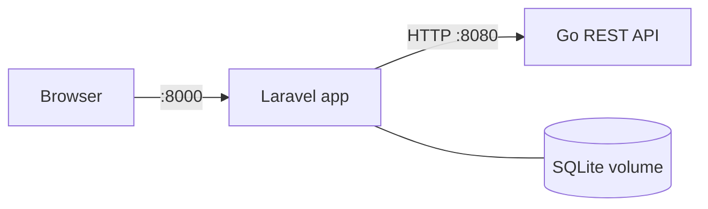
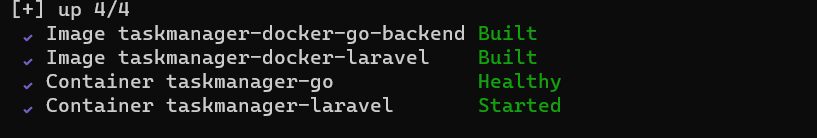
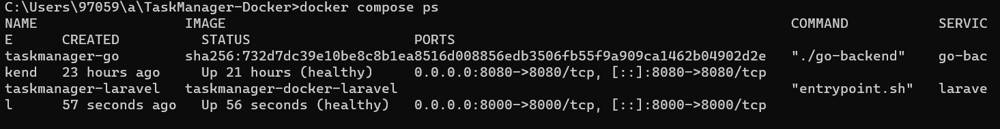
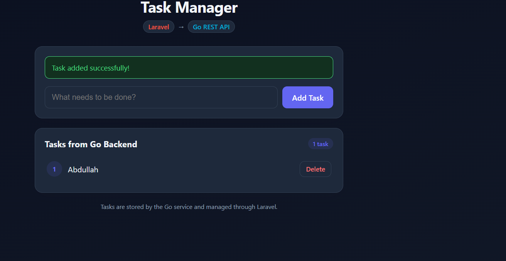
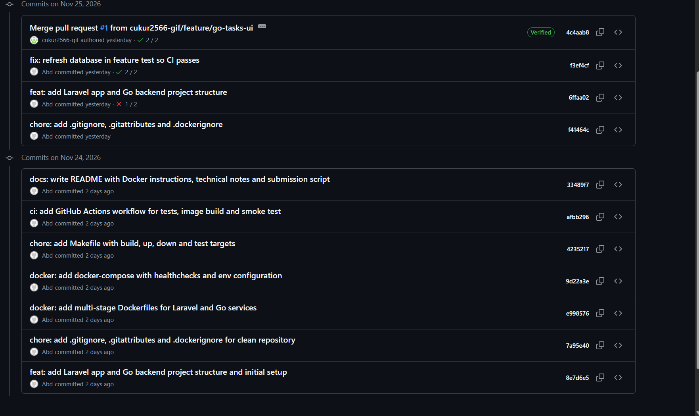

<div align="center">

# TaskManager-Docker

**A containerized task manager: a Laravel web app talking to a Go REST API, running together with a single command.**

[](https://github.com/cukur2566-gif/TaskManager-Docker/actions/workflows/docker-build.yml)


</div>

---

## Table of Contents

- [Overview](#overview)
- [Features](#features)
- [Tech Stack](#tech-stack)
- [Architecture](#architecture)
- [Quick Start](#quick-start)
- [Usage & Testing](#usage--testing)
- [API Reference](#api-reference)
- [Configuration](#configuration)
- [Docker Details](#docker-details)
- [Makefile Commands](#makefile-commands)
- [CI/CD](#cicd)
- [Project Structure](#project-structure)
- [Troubleshooting](#troubleshooting)
- [Screenshots](#screenshots)
- [Attribution & License](#attribution--license)

## Overview

TaskManager-Docker is a small but realistic two-service application built for the OS Lab (Docker & GitHub) assignment. A **Laravel** app provides the user interface and input validation, and delegates task storage to a separate **Go** service over HTTP. Both services are built with multi-stage Dockerfiles and orchestrated with Docker Compose, so any developer can run the whole system with one command and no local PHP, Node or Go installation.

## Features

- Add and delete tasks from a responsive web UI (light and dark mode)
- Input validation and flash messages in Laravel
- Separate Go REST API for task storage
- Multi-stage Docker builds for small, reproducible images
- Healthchecks on both services; Laravel starts only after the API is healthy
- Persistent Laravel data (SQLite) in a named Docker volume
- Auto-generated and persisted `APP_KEY` when none is provided
- GitHub Actions pipeline: tests, image build and end-to-end smoke test
- `Makefile` shortcuts for everyday commands

## Tech Stack

| Layer | Technology |
|---|---|
| Web app | PHP 8.3, Laravel 12, Livewire, Vite, Tailwind CSS, SQLite |
| API | Go (standard library `net/http`), in-memory storage |
| Containers | Docker, Docker Compose, multi-stage builds, healthchecks |
| CI | GitHub Actions |

## Architecture



| Service | Container | Port | Role |
|---|---|---|---|
| `laravel` | `taskmanager-laravel` | 8000 | Web UI, validation, calls the Go API |
| `go-backend` | `taskmanager-go` | 8080 | REST API that stores tasks |

## Quick Start

**Requirements:** [Docker](https://docs.docker.com/get-docker/) with the Compose plugin, and Git.

```bash
# 1. Clone
git clone https://github.com/cukur2566-gif/TaskManager-Docker.git
cd TaskManager-Docker

# 2. (Optional) adjust ports and URL
cp .env.example .env

# 3. Build and start
docker compose up -d --build

# 4. Check status (both services should become "healthy")
docker compose ps
```

Open **http://localhost:8000/go-tasks**.

To stop and clean up:

```bash
docker compose down        # stop and remove containers (keeps data)
docker compose down -v     # also remove the data volume
```

## Usage & Testing

**In the browser:** open http://localhost:8000/go-tasks, add a task, then delete it.

**From the command line** (Linux/macOS/Git Bash):

```bash
curl http://localhost:8080/health
curl -X POST -H "Content-Type: application/json" \
     -d '{"title":"Write README"}' http://localhost:8080/tasks
curl http://localhost:8080/tasks
```

**On Windows CMD:**

```cmd
curl http://localhost:8080/health
curl -X POST -H "Content-Type: application/json" -d "{\"title\":\"Write README\"}" http://localhost:8080/tasks
curl http://localhost:8080/tasks
```

Laravel health endpoint: http://localhost:8000/up

Or run the smoke test with one command: `make test`

## API Reference

### Go service (`:8080`)

| Method | Endpoint | Description | Success |
|---|---|---|---|
| `GET` | `/health` | Liveness check | `200` |
| `GET` | `/tasks` | List all tasks | `200` + JSON array |
| `POST` | `/tasks` | Create a task. Body: `{"title": "..."}` | `201` |
| `DELETE` | `/tasks/{id}` | Delete a task by ID | `200` |

Task object: `{"id": 1, "title": "Write README"}`

### Laravel routes (`:8000`)

| Method | Route | Description |
|---|---|---|
| `GET` | `/go-tasks` | Task list page |
| `POST` | `/go-tasks` | Create a task (forwards to Go) |
| `DELETE` | `/go-tasks/{id}` | Delete a task (forwards to Go) |
| `GET` | `/up` | Health endpoint |

## Configuration

Copy `.env.example` to `.env` and adjust as needed:

| Variable | Default | Description |
|---|---|---|
| `APP_PORT` | `8000` | Host port for the Laravel app |
| `GO_PORT` | `8080` | Host port for the Go API |
| `APP_URL` | `http://localhost:8000` | Public URL (set to your server address on a VPS) |
| `APP_ENV` | `production` | Laravel environment |
| `APP_DEBUG` | `false` | Laravel debug mode |
| `APP_KEY` | *(empty)* | Optional. If empty, a key is generated once and stored in the `/data` volume |

> **Data notes:** Laravel stores its SQLite database in the `laravel_data` volume (`/data/database.sqlite`) and runs migrations automatically on start. The Go API keeps tasks **in memory**, so they reset when the `go-backend` container restarts.

## Docker Details

- **Multi-stage builds.** Node builds the frontend assets, Composer installs production dependencies, and only the results are copied into the final PHP runtime image. The Go service compiles to a static binary and runs on Alpine.
- **Healthchecks.** Both services expose a healthcheck, and `laravel` waits for `go-backend` to be healthy (`depends_on: condition: service_healthy`).
- **Clean build context.** `.dockerignore` excludes `.git`, `vendor`, `node_modules`, `.env` files and local databases.
- **Entrypoint script.** `docker/entrypoint.sh` prepares the environment, persists `APP_KEY`, runs migrations and starts the server. It is needed because `php artisan serve` does not pass most environment variables to the process it starts, so the values are written to `.env` first.
- **Persistence.** The `laravel_data` named volume keeps the database and key across restarts.

## Makefile Commands

| Command | Description |
|---|---|
| `make up` | Build and start the stack in the background |
| `make down` | Stop and remove containers |
| `make logs` | Follow logs of all services |
| `make ps` | Show container status and health |
| `make test` | Run the smoke test against both services |
| `make clean` | Remove containers, local images and the data volume |

`make` is not installed by default on Windows. Use the `docker compose` commands above instead.

## CI/CD

The workflow in [`.github/workflows/docker-build.yml`](.github/workflows/docker-build.yml) runs on every push and pull request to `main`:

1. **`laravel-tests`**: installs dependencies and runs `php artisan test`.
2. **`build-and-test`**: builds both Docker images, starts the stack, waits for the healthchecks and runs a smoke test (create a task, then read it through both services).

## Project Structure

```
.
├── src/
│   ├── laravel-app/              # Laravel application (UI, validation)
│   └── go-backend/               # Go REST API (+ its own Dockerfile)
├── docker/
│   └── entrypoint.sh             # Laravel container startup script
├── docs/
│   ├── screenshots/              # Evidence screenshots
│   └── notes.md                  # Technical notes
├── scripts/
│   └── make_submission_pdf.py    # Builds the submission PDF
├── .github/
│   ├── workflows/docker-build.yml
│   └── pull_request_template.md
├── Dockerfile                    # Laravel image (multi-stage)
├── docker-compose.yml
├── Makefile
├── .env.example
└── README.md
```

## Troubleshooting

| Problem | Fix |
|---|---|
| Port `8000` or `8080` already in use | Change `APP_PORT` / `GO_PORT` in `.env`, then `docker compose up -d` |
| Laravel stays `starting` or `unhealthy` | `docker compose logs laravel` and check for migration or key errors |
| UI changes not showing | Rebuild the image: `docker compose up -d --build laravel` |
| Tasks disappeared | Expected: the Go API stores tasks in memory and resets on restart |
| Need a clean slate | `docker compose down -v` then `docker compose up -d --build` |
| `make` not found on Windows | Use the `docker compose` commands directly |

## Screenshots

| Docker build | Containers running |
|---|---|
|  |  |

| Application | Commit history |
|---|---|
|  |  |

## Attribution & License

Built on the [Laravel](https://laravel.com) skeleton and [Livewire](https://livewire.laravel.com), both MIT-licensed. The rest of the project is original work for the OS Lab assignment.

Released under the MIT License. See [LICENSE](LICENSE).